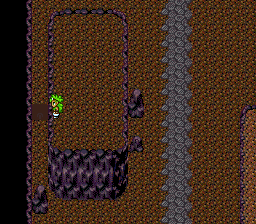
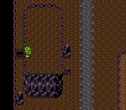
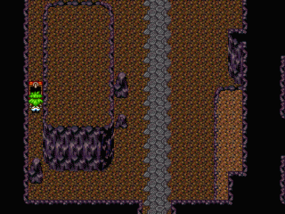

Seen by Cardón on 2026-11-17, sweeping Zounds' chests for
[`zounds-some-chests-change-when-opened`](zounds-some-chests-change-when-opened.md),
with the-advocate `95863f36` and the ports `7ea4469`.

Map 134 ("2", under Cueva, Norte, Pueblo de Misërenia), event 47 at
(2, 30): `object1` character 6, the RTP's red chest, on its first page,
and facing left on its second, on switch 285. On the console it is a dark
brown square closed and a dark silhouette opened; EasyRPG draws it red.

The converter says, for that map:

    map 134: 10 graphic(s) without a palette of their own, drawn with someone else's: …, object1:6
    map 134: WARNING, by where they start up to 32 events are on screen at once and the cache has 27 slots: the ones drawn last wait for one

So it is drawn with another graphic's palette. It is the only chest in
Zounds that the converter lends a palette to (`grep "someone else's"` on
`converter.log`).

To reproduce: the debug room, `go_to_map(134, 2, 31)` in the ports'
harness, or EasyRPG with `--start-map-id 134 --start-position 2 31`.
Captures of both in `/shared/captures/2026-11-17-zounds-chests/`
(`console-map134.png`, `easyrpg-map134.png`).

## Comments

### 2026-11-24, Cardón: a question for taro

**What to decide**: map 134 has more graphics than sprite palettes, and
the converter lends the chest (`object1:6`) someone else's: still so in
the ports' build of 2026-11-24 (`map 134: 10 graphic(s) without a palette
of their own …, object1:6`). Something on that map has to lose its
colours.

**Options**: (a) the lending prefers to keep things the player interacts
with (chests) in their own palette, lending to others instead —a rule for
every game that moves other maps' colours too—; (b) a Zounds patch for map
134 only; (c) leave it.

**Recommendation**: (a) if the measurement shows which graphic would take
the chest's place and it looks better; it changes what is seen on several
maps, so it is yours.

## Log

### 2026-11-22, Carpintero: the captures, in the task

Still so on the-advocate `0ae40e0a` and the ports `89f77b4`: Zounds'
`build/release/converter.log` still lends `object1:6` a palette on map
134, in the same line. The console's two captures above are of that
build, in snes9x from the debug room with the ports' `games.py`
harness: `go_to_map(134, 3, 30)`, the hero beside the chest and facing
it, closed, then A, and opened with switch 285 on. EasyRPG's two are the
first and last frames of Cardón's `easyrpg-map134.png` (the hero below
the chest), at the 320x240 EasyRPG captures; the ports' dump of map 134
has no commit since that day.
