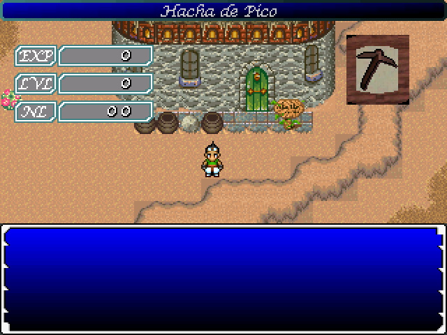
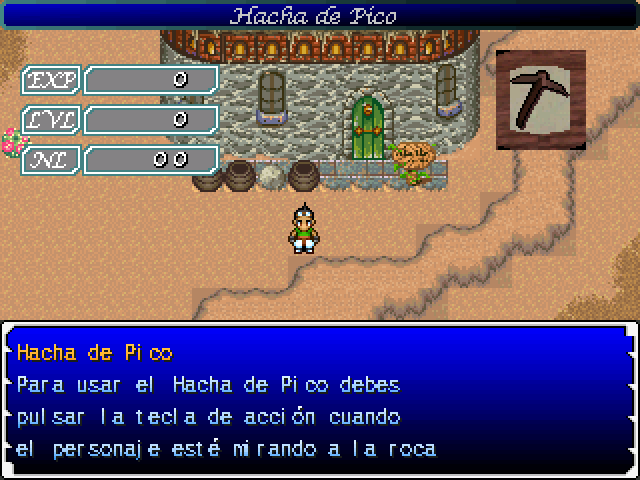
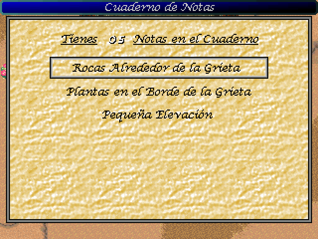

Seen by Carpintero on 2026-10-20, with the-advocate's branch
`carpintero-ce-pictures` (from `3bc68ac4`) and Zounds' `release`, building
[`pictures-in-common-events-compiled-apart-are-not-shown`](pictures-in-common-events-compiled-apart-are-not-shown.md).

Since that branch a common event compiled without a map shows its small
pictures from a table the cartridge shares, and their tiles go up past the
loaded map's sprite bank when one is shown, if the map leaves room for
them —see "The common events' small pictures go up when shown" in the
book's `internals/vram.md`—. Two of Zounds' do not fit on any map, and the
converter's log says so:

* **The pick-axe screen**, common event 21 with the body it calls, 27
  ("Show Mining EXP"): six pictures and the digits of three numbers, cut in
  400 object tiles and **seven sprite palettes**. `Zounds_Dialogue_4`, the
  320x80 gradient box it fades in under its messages, is 384 of the tiles.
  The layouts give the sprites 256 to 512 tiles, and a map's characters
  take some of them and of the eight palettes. The desert, where the
  pick-axe is used (map 34), has no room even for its own `sign`. And its
  104 entries —a digit is a picture under each of its numbers— would take
  most of the 127 the common table names: the converter leaves the set out
  after the smaller ones.
* **The notebook**, common event 29 with 30 and 41: 704 tiles, its five
  lines of notes 190x20 each. Its own background, `Zounds_Notas_Fondo`, is a
  big picture, which hides the map and the small pictures while it is up
  anyway —[`small-pictures-under-a-big-one-are-hidden`](small-pictures-under-a-big-one-are-hidden.md)—.

How to see it: `just cartridges` in `zounds/` of the ports and, in
`build/release/converter.log`, the lines "common events 29, 30, 41: …fit on
none of the 189 maps" and "common events 21, 27: WARNING, their 104 small
pictures aren't shown"; in the game, the item "Hacha de Pico" (23) or
"Cuaderno de Notas" (35) from the item screen shows nothing.

What it would take, as far as it was looked at —not measured—:

* **The characters giving the plane up while the screen is up**: the
  set uploaded from the start of the sprite bank with all eight palettes,
  the characters not drawn, and the map's bank uploaded again when the
  last of its pictures is erased, as after a battle. A divergence the
  player sees —the map's people vanish under the pick-axe's bar—, and
  still short for the pick-axe on a layout of 256 or 384 sprite tiles.
* **The box under the messages as the message window**: `Zounds_Dialogue_4`
  is a window background the game draws as a picture; a port patch that
  leaves it out —the console's own window under the same messages— would
  leave the pick-axe screen some 16 tiles and four or five palettes. A
  decision for taro: it changes how the screen looks.

## Comments

### 2026-11-24, Cardón: a question for taro

**What to decide**: still so in the ports' build of 2026-11-24 (`common
events 29, 30, 41: … fit on none of the 189 maps`; `common events 21, 27:
… 104 small pictures aren't shown`): using the pick-axe or the notebook
shows nothing. The draft already names it a decision of yours.

**Options**: (a) the map's characters give the plane up while such a
screen is up —a divergence: the people vanish—; (b) a Zounds patch that
draws `Zounds_Dialogue_4` as the console's message window, freeing most of
the pick-axe's tiles; (c) leave both out.

**Recommendation**: (b) for the pick-axe, which the game needs to mine;
the notebook, under its own big picture, with (a) only if it matters to
you.

### 2026-11-28, taro: a comment

> Can you attach a screenshot of the original screen running under wine, here?

### 2026-11-28, Hornero: screenshots: to Mulita

Mulita takes the screenshots: the pick-axe and the notebook screens of the original, under Wine, attached here. The question stays open; the task goes back to taro with them.

### 2026-11-28, Mulita: the original's screens, under Wine

Zounds' own `RPG_RT.exe` (RPG Maker 2003), from the game's `master`, run with Wine under Xvfb; captured at the runtime's 640x480, which is RM2003's 320x240 doubled. Our ROM was not captured: there it shows nothing, as the draft says.

**The pick-axe**, "Hacha de Pico" (item 23, common events 21 and 27), on the first frame after using it: the title bar, the EXP / LVL / NL boxes with their digits, the pick-axe sign at the right and, at the bottom, the blue gradient box, `Zounds_Dialogue_4`, before its first message is written:

And with its first message: the text goes over `Zounds_Dialogue_4`, which is what the game uses as its message window here.

**The notebook**, "Cuaderno de Notas" (item 35, common events 29, 30 and 41): the title bar, `Zounds_Notas_Fondo` covering almost the whole map, the count of notes and one line per note, the selector around the first. Three lines and not five because of a mistake in my retouch below (it set only one of switches 83 to 85); the count, 05, is the variable I set.

**What was retouched**, only in a copy of the game in a scratch folder, through `advocate import` / `advocate export`: the party starts on map 34 at (24, 38), in front of the house in the desert, instead of map 183; and the unused common event 69 became a parallel one that, once, gives items 23 and 35, sets variable 30 (notes in total) to 5 and turns on switches 77, 81 and 83 (three of the notes). The rest is the game as it is; the screens were reached from the item menu. The RM2003 runtime asks for its RTP under `HKCU\Software\Enterbrain\RPG2003`; it was given Don Miguel's RTP 2000, which is enough.

Copies in the shared captures folder, `2026-11-28-zounds-pick-axe-notebook`.

## Log

### 2026-11-28, Mulita: the original's screenshots

The pick-axe and the notebook screens of the original, run with Wine, in the comment above; back to `draft` with `assignee: taro`, since the question in Cardón's comment is still theirs.
