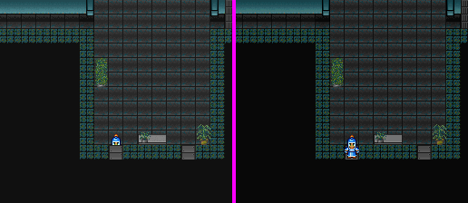

taro, 2026-11-22, frames in `/shared/bug-reports-etc/zounds-bug-roof/`, on
the build of the ports `e886c7e` and the-advocate `7e8da728`:

> Map 19, "Pasillo Este" of the Hover Tram, door to Kazar's room, event
> Puerta A-1.
>
> Up to frame 56343: Unamë is under the door. 56344 on: Unamë is over the
> door. The fade-out happens normally.

## Log

### 2026-11-22, Hornero: taken for Mulita

### 2026-11-22, Mulita: the door's open page was never followed

#### What RM2k shows

Event 1 of map 19, "Puerta A-1" at (14, 36), has two pages, both drawing
upper tile 60 of the ChipSet: the first, without conditions, **on the
hero's layer** and action-triggered ("La puerta está cerrada."); the
second, with switch 23, **above the hero**, touch-triggered, with a sound
and a `Teleport` to map 25. So with the door open the hero walks onto its
cell and RPG_RT draws the door over him until the fade-out ends: an event
above the hero is `Priority_EventsAbove` (60) against the hero's
`Priority_Player` (40), whatever its Y (EasyRPG's
`Game_Character::GetScreenZ`, `drawable.h`). **The "under" frames are
right; the "over" ones, from 56344, are the bug.**

#### Why

Reproduced from the debug room —switch 23 on, a jump to (14, 34) of map
19, holding down—: the door's row in `npc_buf` carried the sort key
`$1240`, the hero's layer and Y 576, and priority `$10`, not `$2240` and
`$20`. While the hero walked in, his Y was smaller and the door won;
the frame he arrived, the keys tied and `build_oam` puts the hero first on
a tie, so he was drawn over it, and the touch page started the fade on
that same frame.

The row never took the open page's layer because `collect_npcs`, in
wally's `events.rs`, decides whether a row follows the active page
(`changes`, bit 5 of the page record, which `page_graphic` in the
runtime's `event_pages.s` looks at) only by the **graphic** its pages
draw: both draw tile 60, so the event was taken as one whose look never
changes. The runtime already takes the layer and the transparency from
the page when the row follows it —that is how Desert Nightmare's Jake
works—; what was missing was saying that a page that only changes those
is a change too.

#### The fix

`collect_npcs` compares each page's look as its graphic plus, when it
draws one, its layer and transparency. the-advocate `1d5be7dc`, branch
`mulita-door`:

* wally's unit test `a_page_that_only_moves_the_graphic_above_the_hero_is_followed`,
  red before;
* the test game's doors, map 12, gets an awning, event 6 at (15, 11):
  upper tile 39 on the hero's layer that A opens with switch **1441**, and
  a second page with the same tile above the hero.
  `test_above_the_hero_by_its_page.py` compares the awning's cell with the
  hero on it against the hero two cells away: red in snes9x and bsnes
  with the tools before, green after.

Ports `5be92bf`, branch `mulita-door`: `test_zounds_door_above_the_hero.py`
walks onto the door frame by frame and counts the pixels with colour inside
its grey panel, from the frame the hero stands on its cell until map 19 is
left: 132 with the global tools (frame 8, his second on the cell), 0 with
the fix.

#### What was run

All with `.local-tools` holding only `wally`, the one project touched;
the runtime is not changed. the-advocate `just test`: green.
`SOUNDFONT=…/FluidR3_GM.sf2 just test-game`: 210 passed, 6 skipped. ABL's
`just tests`: 1686 passed, 2 skipped. The ports' root `just boot`: 202
passed. **No golden moved.** Main was still at the-advocate `7e8da728` and
ports `769676f` when finishing, so there was nothing to merge.

Beyond Zounds, the same shape —pages with the same graphic, differing only
in layer or transparency— is in about a hundred events of the other ports
(Vampires Dawn the most: map 28's tiles that drop from above the hero to
below it with a switch; Dooms 2, El Dorado, Sunset, Desert Nightmare, ABL's
map 277): they now follow their page too. The suites cover none of those
events by name; no golden of theirs moved.

Captures in `/shared/captures/2026-11-22-zounds-door/`: map 19 before and
after, and the test game's awning.

To install when merging: `just install wally`.
